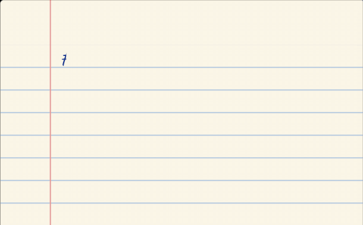
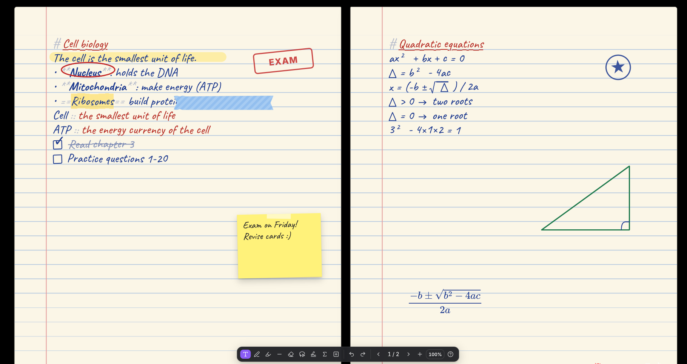
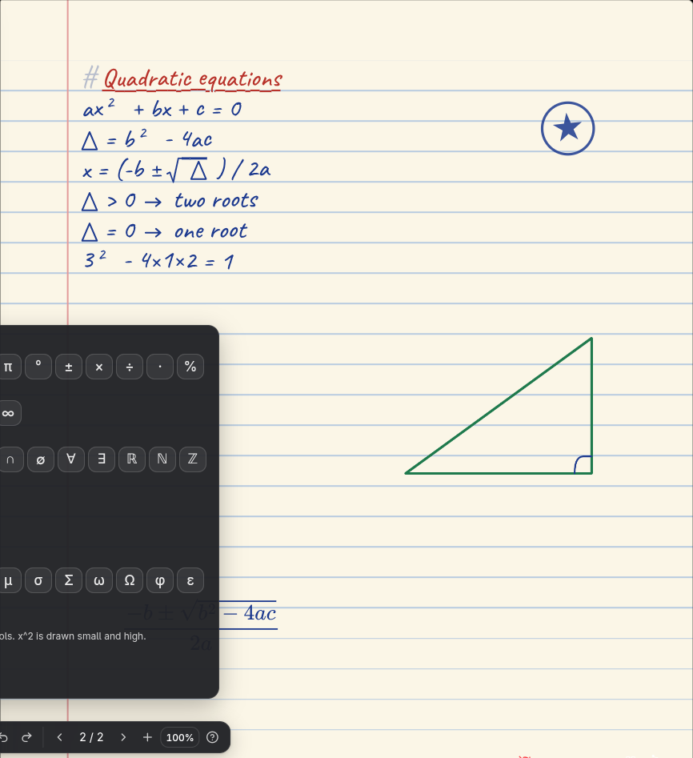
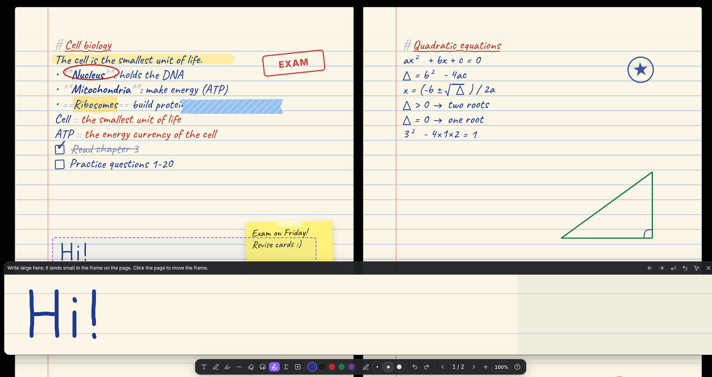
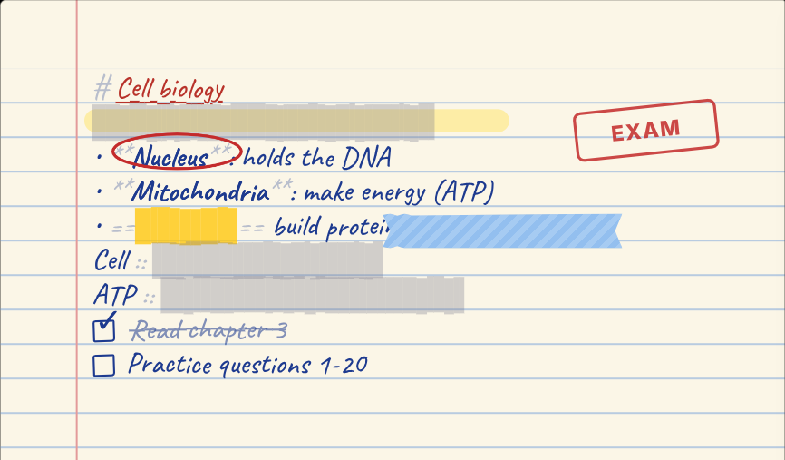
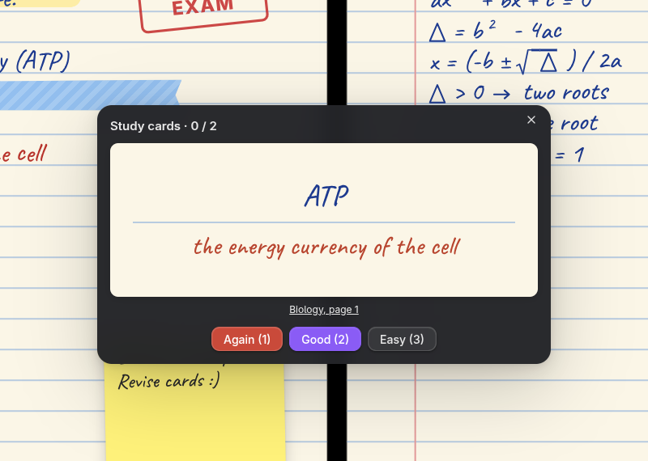
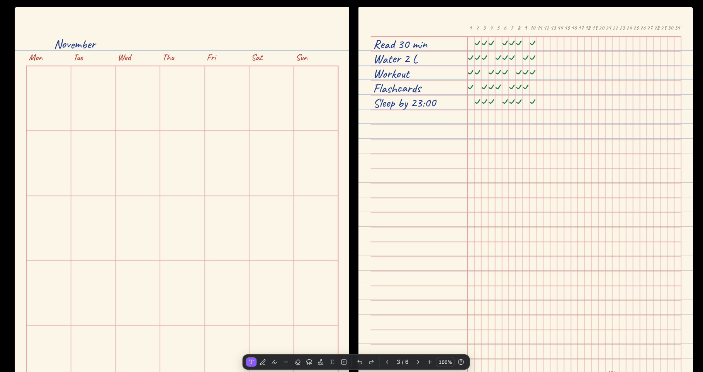
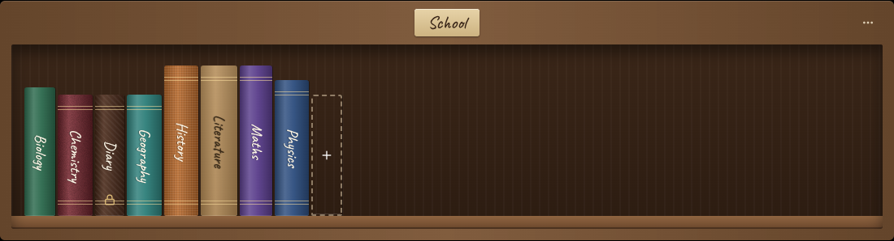
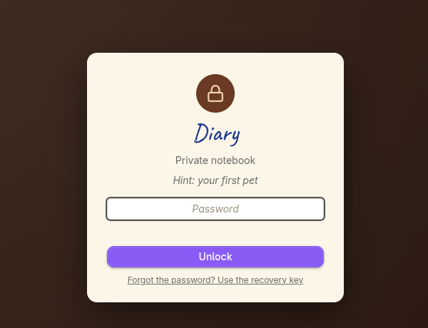
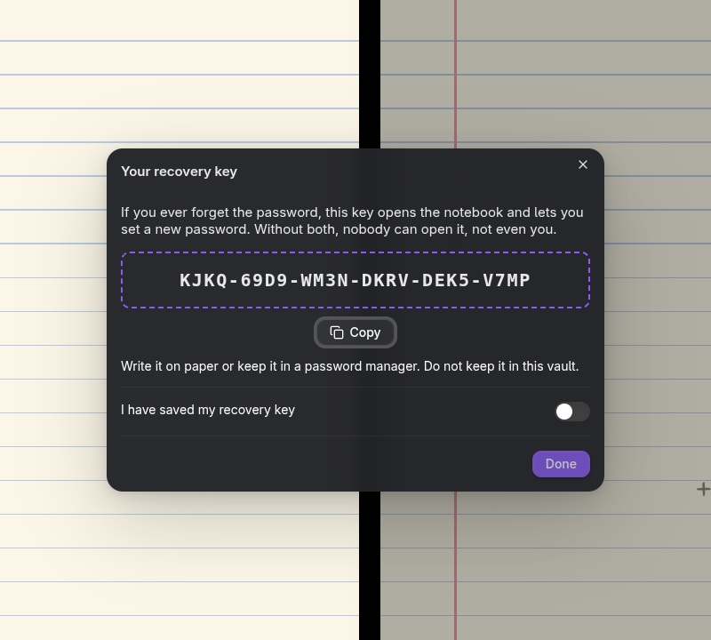

# Defter

**A paper notebook for [Obsidian](https://obsidian.md) that you write in with your keyboard.** Type, and your words appear in animated handwriting on real-looking paper. Draw and highlight with the mouse, a touchpad or a stylus. Study with flashcards, hide-and-reveal and a Pomodoro timer. Every notebook is a plain Markdown file.

<p align="center">
  
</p>



> *Defter* means "notebook" in Turkish. Status: v0.5, desktop and mobile (tablets with a stylus welcome). Interface in English and Turkish.

## Why

Handwritten notes are easier to remember and nicer to look at, but most of us type faster than we write, and not everyone has a tablet and a pen. Defter gives you both: the speed of the keyboard and the look and feel of a paper notebook, inside the vault you already use.

## Features

### Write

- **Handwriting as you type.** Four handwriting fonts (Caveat, Kalam, Patrick Hand, Shantell Sans), or **your own handwriting** as a font. Each letter is drawn like a pen stroke; text always sits on the lines.
- **Markdown that looks like ink.** `# heading`, `**bold**`, `==marker==`, `- lists`, `[ ] to-dos` you can tick, and `[[links]]`.
- **Coloured text.** In write mode the pencil case shows eight ink colours: colour the selection, or keep typing in a colour. The colour is stored with invisible marks, so the Markdown file still reads cleanly.
- **Pages that turn.** When a page is full, writing continues on the next one. Two pages lie open side by side on a wide screen, with a page-turn animation.
- **Maths without a maths keyboard.** `\sqrt` → √, `\pi` → π, `<=` → ≤, `!=` → ≠, `->` → →; `x^2` and `a_1` are written small and high or low; `√(a+b)` gets its bar. Symbols the fonts lack are drawn by hand. A **Σ panel** has every symbol, and a **calculator** answers `12*3+4 =` when you press Tab. Formulas in an **easy syntax** (`sqrt(x+1)/2`) or LaTeX.



### Draw

- **A pencil case at the bottom:** ballpoint, fountain pen (the line swells and thins with speed), pencil, dashed pen; highlighter that stays under the text; line, arrow, box, circle and triangle; eraser; lasso to move, resize, recolour, copy, duplicate or **save as a sticker**.
- **Draw and hold** to turn a rough shape into a clean line, triangle, box or circle.
- **Write pad:** a large strip at the bottom where you write big letters with the mouse or **touchpad**; they land small and neat on the page line while the frame moves along. In touchpad mode you just move your finger and hold Space.
- **Stylus support** on tablets: pressure changes the line width, fingers scroll, palms are ignored.
- Pictures (paste a screenshot with Ctrl+V), sticky notes, stamps (✓ ★ EXAM …), hide tape, and **PDF pages you can write on** (import a worksheet or slides).



### Study

- **Flashcards:** write `question :: answer` on any line. The cards button quizzes you with a five-box Leitner schedule (1, 2, 4, 8, 16 days), across one or all notebooks.
- **Study mode (Alt+S):** highlighted text and card answers disappear; click to reveal. **Hide tape** covers anything until you click it.
- **To-dos** with a list of every open one, a **Pomodoro timer** (25+5, 50+10 or stopwatch) and study time per notebook in the library.
- **Planner pages:** weekly plan, monthly calendar, habit tracker, practice exam tracker, reading list; plus Cornell notes, question & solution, formula sheet and cover page.

<p>
  
  
</p>



### Keep

- **A real library:** every folder is a wooden bookcase, notebooks stand on the shelves; drag to reorder or move between bookcases. Leather, cloth or kraft covers.
- **Journal:** one page per day, opens on today with the date at the top; a calendar jumps to any day.
- **Private notebooks:** lock any notebook (your journal, for example) with a password. The pages are **encrypted in the file** (AES-GCM 256, key derived with PBKDF2-SHA256, 310 000 rounds). A **recovery key** shown once at setup lets you set a new password if you forget it. Private notebooks are hidden from the library unless you choose to show them, and lock themselves after a few idle minutes.
- **Look your way:** A4, B5, A5 or square pages; ruled, grid, dotted, blank, music or engineering paper; cream, white, dark, kraft or aged paper; spiral or stitched binding; ink colours and text sizes.
- Search inside a notebook, page thumbnails, bookmark tabs, zoom, focus mode, PDF export, copy a page as an image.



<p>
  
  
</p>

## Install

Defter is not in the community plugin list yet. Until then:

- **With BRAT:** install the [BRAT](https://github.com/TfTHacker/obsidian42-brat) plugin, choose *Add beta plugin* and enter `HIMURAw/defter`.
- **By hand:** download `main.js`, `manifest.json` and `styles.css` from the [latest release](https://github.com/HIMURAw/defter/releases) into `<your vault>/.obsidian/plugins/defter/`, then enable *Defter* in *Settings → Community plugins*.

On first start a short tour shows the main ideas and can open a welcome notebook with an example of every feature.

## Use

| | |
|---|---|
| Open the library | ribbon icon, or **Defter: Open library** |
| New notebook | the **+** book on a shelf, right-click a folder → **New notebook**, or **Defter: New notebook** |
| Tools | `Alt+1` write · `Alt+2` pen · `Alt+3` highlighter · `Alt+4` eraser · `Alt+5` shapes · `Alt+6` select · `Alt+7` write pad |
| Pages | `Page Up` / `Page Down`, the arrows in the pencil case, the page list or thumbnails |
| Study | `Alt+S` study mode, the cards and timer buttons in the header |
| Maths | the Σ button; `\sqrt`, `\pi`, `x^2`; `12*3 =` then Tab |
| Everything else | `F1` lists every shortcut |

Settings for each notebook are behind the sliders icon in its header; defaults, language, maths, private notebooks, sound and your own font are in **Settings → Defter**.

## File format

A notebook is a Markdown file. Page text stays readable and searchable; drawings live in one comment block at the end.

```markdown
---
defter-plugin: notebook
defter-paper: grid
---

<!-- defter:page -->
# Quadratic equations
x^2 - 5x + 6 = 0

<!-- defter:page date=2026-11-10 tpl=qa -->
Text of page two.

<!-- defter:ink
{"v":1,"pages":[[],[{"t":"pen","c":"#1d3a8f","w":3.5,"p":[100,212,180,214]}]]}
-->
```

- Look: `defter-page`, `defter-paper`, `defter-tone`, `defter-font`, `defter-size`, `defter-ink`, `defter-cover`, `defter-cover-style`, `defter-binding`; `defter-journal: true` for a journal.
- Page markers can carry `date=`, `tpl=` (template), `mark=` (bookmark colour) and `bg=` (URI-encoded path of a page background, e.g. an imported PDF page).
- Strokes: `t` (pen/hl), `c` colour, `w` width, `p` points, optional `s` shape (`line`, `arrow`, `rect`, `ellipse`, `tri`, `poly`), `y` pen (`fountain`, `pencil`, `dash`) and `q` stylus pressure per point. Objects (pictures, notes, formulas, tape, stamps) are in `objects`.
- A **private** notebook keeps its frontmatter plain (plus `defter-lock: v1`) and replaces the pages with one `<!-- defter:locked … -->` block: the notebook key wrapped by the password and by the recovery key, and the encrypted notebook. Pictures and PDF pages are separate files and are not encrypted.
- Flashcard progress, study minutes and stickers are kept in the plugin's settings, never in your notes. Card progress is keyed by a hash, so no card text is stored there.

## Translate

All interface text goes through one function, and each language is one file in [`src/lang/`](src/lang). To add a language, copy `tr.ts`, translate the values, and register it in `src/i18n.ts`. A test checks that no text is missing.

## Development

```bash
npm install
npm test          # format, flashcards, maths, encryption and translation tests
npm run build     # main.js + styles.css (fonts are embedded)
DEFTER_VAULT=/path/to/vault npm run deploy
```

## License

MIT. The bundled fonts (Caveat, Kalam, Patrick Hand, Shantell Sans) are under the SIL Open Font License 1.1 (`fonts/OFL-*.txt`).

---

### Türkçe

Defter, Obsidian içinde klavyeyle yazdığın, yazının el yazısı olarak çıktığı bir defter eklentisi. Kalem, fosforlu kalem, şekiller, yazma kutusu (fare ve touchpad ile yazma), bilgi kartları, çalışma modu, Pomodoro, matematik sembolleri ve hesap makinesi, şifreli özel defterler (kurtarma anahtarıyla), kitaplık, günlük ve planlayıcı sayfaları var. Arayüz Türkçe: **Ayarlar → Defter → Language → Türkçe** (Obsidian Türkçeyse kendiliğinden).
